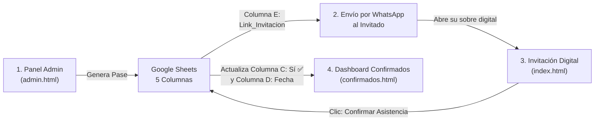

# 📖 Guía y Tutorial Maestro: Google Sheets con 5 Columnas

Esta guía explica en detalle cómo funciona la base de datos en Google Sheets para tus invitaciones digitales y cómo configurarla en 2 minutos con **solo copiar y pegar**.

---

## 🎯 ¿Qué necesita el Google Sheets y para qué sirve cada cosa?

Para gestionar los invitados de un evento (XV Años, Boda o Fiesta), **solo necesitas 1 archivo de Google Sheets común y corriente en Google Drive**. No necesitas pagar bases de datos externas ni servidores.

El sistema funciona con **5 Columnas exactas**:

| Columna | Nombre de Cabecera | ¿Para qué sirve? | Ejemplo |
| :---: | :---: | :--- | :--- |
| **A** | **`Nombre`** | El nombre o apellido de la familia o del invitado de honor. | `Familia Morales Rodríguez` |
| **B** | **`Pases`** | El número de boletos o lugares reservados para esa persona o familia. | `2` o `4` |
| **C** | **`Confirmado`** | El estado de asistencia. Empieza como `Pendiente` y cambia a `Sí ✅` cuando el invitado confirma. | `Sí ✅` o `Pendiente` |
| **D** | **`Fecha_Confirmacion`** | Se llena automáticamente en el momento exacto en que el invitado presiona "Confirmar asistencia". | `11/10/2026, 14:35:10` |
| **E** | **`Link_Invitacion`** | El enlace web personalizado con sus pases. Queda guardado aquí para que tú o tu cliente lo copien en cualquier momento sin tener que volver a generarlo. | `https://alvapcompany.github.io/invitaciones_Fiestas/XV/Valeria/?n=Familia%20Morales&p=2` |

> [!TIP]
> **No necesitas escribir las cabeceras a mano.**
> El código Apps Script revisa si la hoja está vacía al primer uso y **crea automáticamente los 5 títulos en color dorado/amarillo con texto en negrita y fila fijada**.

---

## 🔄 ¿Cómo es el flujo automático entre la web y tu Google Sheets?



1. **Cuando tú o tu cliente crean un pase en `admin.html`**:
   - Escribes `Familia Morales Rodríguez` y `2` lugares.
   - Presionas **"Generar Invitación Digital"**.
   - Se crea una fila en Google Sheets:
     `[Familia Morales Rodríguez] | [2] | [Pendiente] | [] | [https://.../?n=Familia%20Morales&p=2]`

2. **Envío al invitado por WhatsApp**:
   - Copias el enlace o das clic en el botón verde de WhatsApp.
   - El invitado recibe su link exclusivo.

3. **Cuando el invitado confirma en `index.html`**:
   - El invitado abre su sobre interactivo con cera real, ve cuántos pases tiene asignados y da clic en **"Confirmar Asistencia"**.
   - En ese mismo segundo, la página envía la confirmación a tu Google Sheets.
   - El código busca su fila en la hoja y:
     - Cambia `Confirmado` a **`Sí ✅`**.
     - Escribe la fecha y hora en `Fecha_Confirmacion` (ej: `11/10/2026, 14:35:10`).
     - ¡Todo sin duplicar filas!

4. **Monitoreo en tiempo real (`confirmados.html`)**:
   - Tu cliente puede ver en su pantalla quiénes ya confirmaron, cuántos lugares faltan por confirmar y cuántos pases totales van en el evento.

---

## ⚡ Paso a Paso: Cómo instalar el código en Google Sheets (Menos de 2 minutos)

### 1. Crear la Hoja en Google Drive
1. Entra a [Google Sheets (drive.google.com)](https://sheets.google.com).
2. Crea una **Hoja de cálculo en blanco**.
3. Ponle el nombre que quieras arriba a la izquierda, por ejemplo: `Invitados XV Valeria` o `Invitados Boda Sofia y Mateo`.

### 2. Abrir Google Apps Script
1. En el menú superior de tu hoja de Google Sheets, ve a:  
   👉 **Extensiones > Apps Script**
2. Se abrirá una ventana de edición de código con un archivo llamado `Código.gs`.
3. **Borra todo el texto que aparezca** en la ventana blanca.

### 3. Pegar el Código Maestro
Copia y pega este código completo (también está guardado en el archivo `codigo_google_sheets.js` en la raíz de tu proyecto):

```javascript
/**
 * ============================================================================
 * 📋 CÓDIGO MAESTRO DE GOOGLE APPS SCRIPT PARA GOOGLE SHEETS
 * Estructura de 5 Columnas:
 * [Nombre] | [Pases] | [Confirmado] | [Fecha_Confirmacion] | [Link_Invitacion]
 * ============================================================================
 */

// 🟢 FUNCIÓN DE PRUEBA Y CREACIÓN DE COLUMNAS (Para el botón "▷ Run" / "▷ Ejecutar")
function inicializarHoja() {
  var sheet = SpreadsheetApp.getActiveSpreadsheet().getActiveSheet();
  setupHeadersIfEmpty(sheet);
  Logger.log("✅ ¡Conexión exitosa! Las 5 columnas quedaron configuradas en tu hoja de Google Sheets.");
}

// Crea las 5 columnas automáticamente si la hoja está vacía
function setupHeadersIfEmpty(sheet) {
  if (!sheet) {
    sheet = SpreadsheetApp.getActiveSpreadsheet().getActiveSheet();
  }
  if (sheet.getLastRow() === 0) {
    sheet.appendRow(["Nombre", "Pases", "Confirmado", "Fecha_Confirmacion", "Link_Invitacion"]);
    sheet.getRange("A1:E1").setFontWeight("bold").setBackground("#fef08a").setFontColor("#1a1202");
    sheet.setFrozenRows(1);
  }
}

// LECTURA DE INVITADOS (GET) -> Lee la hoja para el Panel Admin y Confirmados
function doGet(e) {
  try {
    var sheet = SpreadsheetApp.getActiveSpreadsheet().getActiveSheet();
    setupHeadersIfEmpty(sheet);
    
    var rows = sheet.getDataRange().getValues();
    var result = [];
    
    // Si solo están los encabezados en la fila 1
    if (rows.length <= 1) {
      return ContentService
        .createTextOutput(JSON.stringify([]))
        .setMimeType(ContentService.MimeType.JSON);
    }
    
    // Recorremos desde la fila 2
    for (var i = 1; i < rows.length; i++) {
      var nom = rows[i][0] ? rows[i][0].toString().trim() : "";
      if (nom !== "") {
        result.push({
          nombre: nom,
          familia: nom, // Compatibilidad con ambos nombres
          pases: rows[i][1] ? parseInt(rows[i][1]) || 1 : 1,
          confirmado: rows[i][2] ? rows[i][2].toString().trim() : "Pendiente",
          fecha_confirmacion: rows[i][3] ? rows[i][3].toString() : "",
          link_invitacion: rows[i][4] ? rows[i][4].toString().trim() : "",
          link: rows[i][4] ? rows[i][4].toString().trim() : ""
        });
      }
    }
    
    return ContentService
      .createTextOutput(JSON.stringify(result))
      .setMimeType(ContentService.MimeType.JSON);
      
  } catch (err) {
    return ContentService
      .createTextOutput(JSON.stringify({ error: err.toString() }))
      .setMimeType(ContentService.MimeType.JSON);
  }
}

// ESCRITURA Y ACTUALIZACIÓN (POST) -> Guarda pases generados o confirmaciones
function doPost(e) {
  try {
    var sheet = SpreadsheetApp.getActiveSpreadsheet().getActiveSheet();
    setupHeadersIfEmpty(sheet);
    
    var data = JSON.parse(e.postData.contents);
    var nombre = (data.nombre || data.familia || "").toString().trim();
    var pases = data.pases ? parseInt(data.pases) : 1;
    var confirmado = (data.confirmado || "Sí ✅").toString().trim();
    var fecha = data.fecha_confirmacion || (confirmado.toLowerCase().includes("sí") ? new Date().toLocaleString("es-MX") : "");
    var link = (data.link_invitacion || data.link || "").toString().trim();
    
    if (!nombre) {
      return ContentService
        .createTextOutput(JSON.stringify({ status: "error", message: "Nombre no especificado" }))
        .setMimeType(ContentService.MimeType.JSON);
    }
    
    var rows = sheet.getDataRange().getValues();
    var encontrada = false;
    
    // Buscar si el invitado ya existe para actualizarlo
    for (var i = 1; i < rows.length; i++) {
      if (rows[i][0] && rows[i][0].toString().trim().toLowerCase() === nombre.toLowerCase()) {
        if (data.pases) {
          sheet.getRange(i + 1, 2).setValue(pases);
        }
        if (data.confirmado) {
          sheet.getRange(i + 1, 3).setValue(confirmado);
        }
        if (fecha) {
          sheet.getRange(i + 1, 4).setValue(fecha);
        }
        if (link) {
          sheet.getRange(i + 1, 5).setValue(link);
        }
        encontrada = true;
        break;
      }
    }
    
    // Si no existía, agregar una nueva fila al final
    if (!encontrada) {
      sheet.appendRow([nombre, pases, confirmado, fecha, link]);
    }
    
    return ContentService
      .createTextOutput(JSON.stringify({
        status: "success",
        nombre: nombre,
        pases: pases,
        confirmado: confirmado,
        link_invitacion: link
      }))
      .setMimeType(ContentService.MimeType.JSON);
      
  } catch (err) {
    return ContentService
      .createTextOutput(JSON.stringify({ status: "error", error: err.toString() }))
      .setMimeType(ContentService.MimeType.JSON);
  }
}
```

### 4. Implementar como Aplicación Web (Paso Crucial)
1. Arriba a la derecha haz clic en el botón azul: **"Implementar" (Deploy) > "Nueva implementación"**.
2. Al lado de "Selecciona el tipo", haz clic en el engrane ⚙️ y elige **"Aplicación web"**.
3. Llena estos 3 valores:
   - **Descripción:** `API Invitaciones`
   - **Ejecutar como:** `Yo (tu_correo@gmail.com)`
   - **Quién tiene acceso:** **`Cualquier persona`** *(Anyone)*  ⚠️ **(¡Obligatorio para que los celulares de los invitados puedan conectar!)**
4. Haz clic en **"Implementar"**.
5. Autoriza los permisos de Google:
   - Haz clic en tu cuenta de Google.
   - Si dice *"Google no ha verificado esta aplicación"*, haz clic en **"Configuración avanzada"** (Advanced) y luego en **"Ir a Proyecto (no seguro)"**.
   - Haz clic en **"Permitir"**.
6. Copia la **URL de la aplicación web** (la que termina en `/exec`).

---

## 🔗 Vincular la URL con el Evento

Una vez que tienes tu URL (`https://script.google.com/macros/s/.../exec`), puedes:

1. **Probarla en tu Super Admin Privado**:
   - Abre `superadmin.html` en tu navegador.
   - Pega la URL en la herramienta de prueba y haz clic en **"Probar Conexión con Google Sheets"**. Si responde en verde, ¡está 100% activa!

2. **Pegarla en los archivos del cliente**:
   - En la carpeta de ese cliente, abre `index.html`, `admin.html` y `confirmados.html`.
   - Busca la línea:
     ```javascript
     GOOGLE_SHEETS_URL: ''
     ```
   - Pega tu URL dentro de las comillas:
     ```javascript
     GOOGLE_SHEETS_URL: 'https://script.google.com/macros/s/AKfycb.../exec'
     ```
   - Haz `git add .`, `git commit -m "conectar sheets cliente"` y `git push`.
